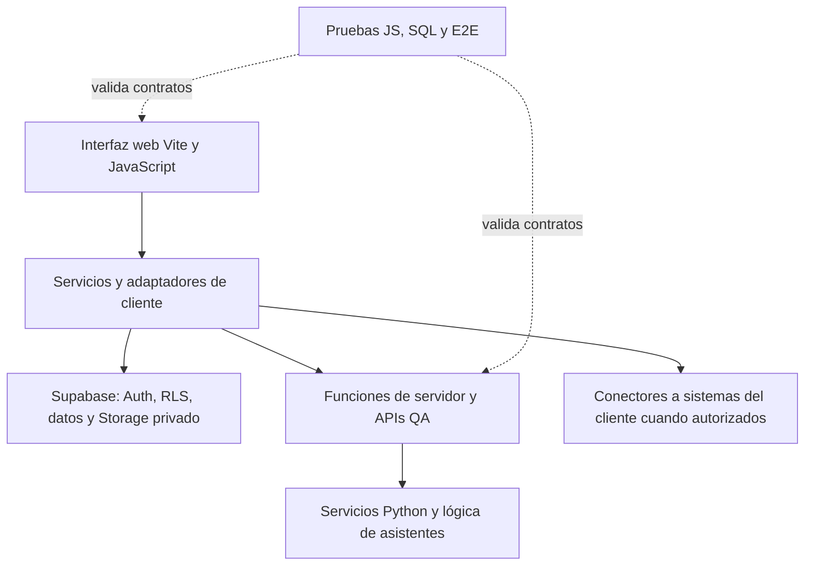

# ADPHOR — Arquitectura general

Esta vista documenta el reparto de responsabilidades observado en el código y el árbol del repositorio. No es una afirmación de disponibilidad de sistemas externos.

## Vista por capas

## Carpetas y responsabilidades

| Componente | Ubicación | Lectura técnica |
| --- | --- | --- |
| Entrada de frontend | `index.html`, `src/js/app.js` | Inicialización y composición de la interfaz |
| Interfaz funcional | `src/js/ui-*.js`, `src/css/` | Presentación por pantallas |
| Servicios de dominio | `src/js/services/` | Contratos de acceso, operaciones y adaptadores |
| Funciones web | `functions/` | Rutas de servidor y control de entrada |
| Núcleo Python | `backend/src/adphor_ai/`, `backend/src/worker.py` | Orquestación, reglas y contratos de asistencia |
| Base de datos | `supabase/migrations/`, `supabase/functions/` | Esquema, RLS y funciones de QA |
| Validación | `tests/`, `backend/tests/`, `supabase/tests/`, `qa/` | Pruebas y evidencia aislada |
| Automatización | `.github/workflows/` | Comprobaciones CI y gates |

## Fronteras de seguridad

- La identidad y los permisos deben validarse en el servidor y en las políticas RLS; no confiar únicamente en la interfaz.
- El acceso a copropiedades debe respetar membresías y nivel MFA/AAL2 cuando aplique.
- Los documentos privados y evidencias nunca deben publicarse como archivos del repositorio o recursos estáticos de la web.
- Las claves sensibles pertenecen al servidor o al proveedor de secretos, nunca a variables `VITE_*` ni a commits.
- Las fuentes originales privadas del cliente deben permanecer separadas de los componentes públicos.

## Integración y fases

La base de seguimiento de mantenimiento está descrita en el [README histórico](../README.md). La rama [QA Integral](https://github.com/riano200612-jpg/adphor-platform/tree/qa/integral-claude-reviewed-20261111) añade componentes para reuniones, PQRS, visitas, asistencia virtual, IAM, directorios y herramientas de pruebas. Algunas integraciones con servicios del cliente pueden seguir pendientes o ser simuladas; consulte el mapa de módulos, PR y pruebas antes de considerarlas operativas.

## Cómo validar una funcionalidad

Localice primero la pantalla, su servicio, el contrato de datos, las políticas de seguridad y los tests. Después confirme qué tipo de evidencia existe: prueba sintética, prueba aislada, validación autenticada o aceptación del cliente. No mezcle esas categorías.

Los cambios de arquitectura requieren revisión técnica independiente; este documento no introduce dependencias ni modifica las originales.
