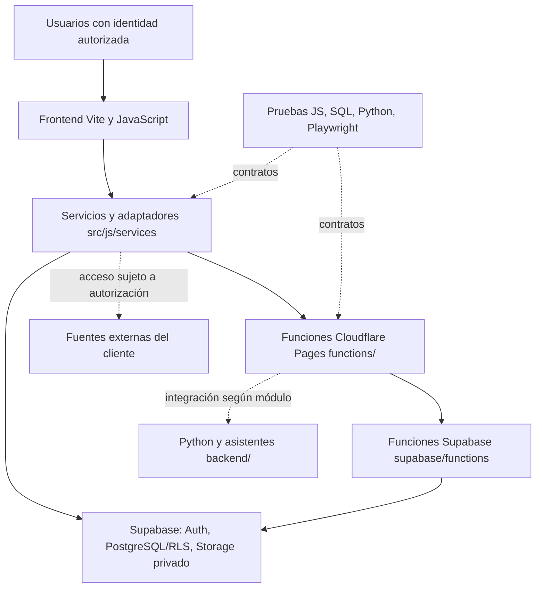

# ADPHOR — Arquitectura técnica

**Naturaleza:** inventario arquitectónico observado en código. **No acredita** servicios externos activos o certificados.

## Capas principales

*Las líneas discontinuas indican integración condicionada; no representan una conexión en vivo verificada.*

## Separación de responsabilidades

| Capa | Ubicación | Responsabilidad |
| --- | --- | --- |
| UI | `src/js/app.js`, `src/js/ui-*.js`, `src/css/` | Pantallas, interacción y estados |
| Cliente | `src/js/services/` | Lectura, comandos y contratos de transporte |
| Servidor | `functions/`, `supabase/functions/` | Validaciones y operaciones del lado servidor |
| IA | `backend/src/adphor_ai/` | Contratos, reglas, orquestación y aprobación |
| Persistencia | `supabase/migrations/` | Modelo SQL, políticas y evolución |
| Verificación | `tests/`, `backend/tests/`, `qa/` | Casos aislados y evidencia reproducible |

## Ejemplo de trazado de una operación

**IAM:** `src/js/ui-iam-live.js` → `src/js/services/iam-client.js` → `functions/api/iam.js` / `supabase/functions/adphor-iam/` → pruebas `tests/qa-iam-api.test.js`.

**PQRS:** `src/js/ui-pqrs.js` → `src/js/services/qa-case-evidence.js` → políticas de almacenamiento y `tests/e2e/pqrs-evidence-persistence.spec.js`.

Esos recorridos son puntos de inspección, no garantía de que el tráfico real recorra todas las piezas en cada despliegue.

## Fronteras de diseño

- Toda autorización debe comprobarse en servidor y RLS, no solamente ocultando UI.
- El alcance por copropiedad y el nivel AAL2 se validan según la política de acceso.
- Las evidencias y los documentos privados no son recursos estáticos del repositorio.
- Los asistentes no deben ejecutar cambios no autorizados por una persona.
- Integraciones de calendario, documentos y sistemas originales requieren acceso separado y validación.

Más detalle: [Seguridad](SEGURIDAD_Y_DATOS.md), [Integraciones](CONTRATOS_E_INTEGRACIONES.md), [Módulos](MAPA_DE_MODULOS.md).